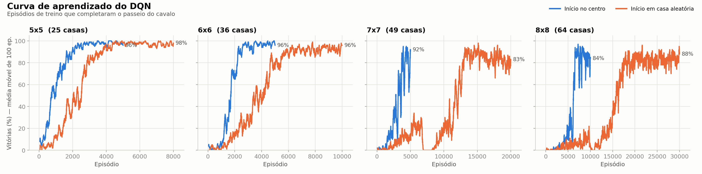
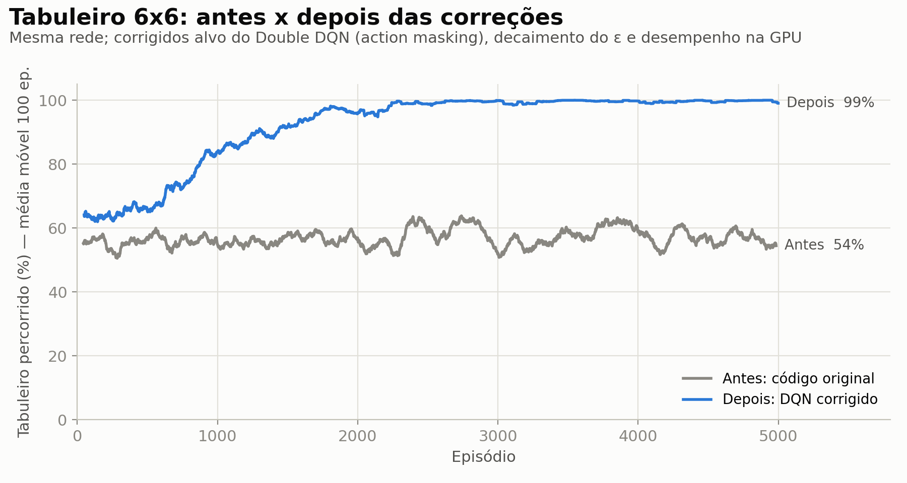
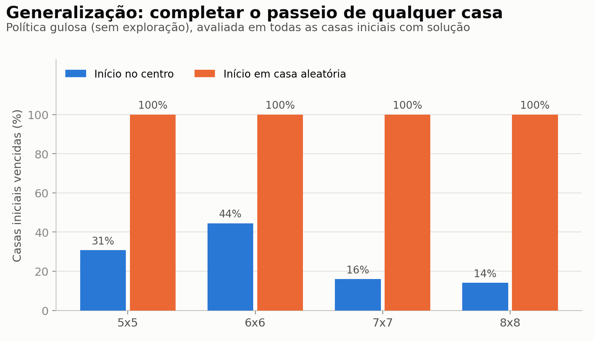
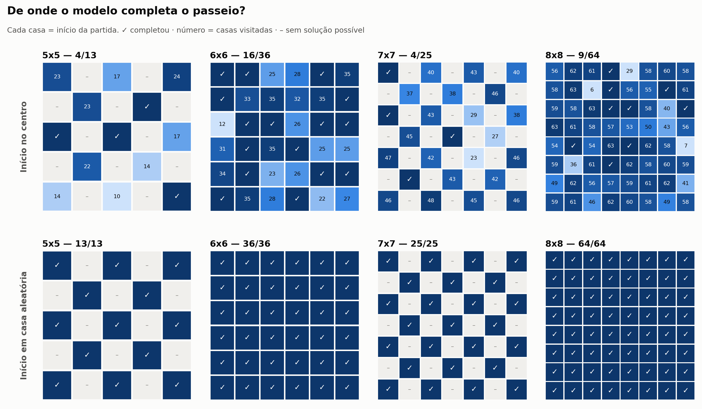

# 🐎 Cavalo Solitário (Knight's Tour)

Um jogo clássico de quebra-cabeça de xadrez onde o cavalo deve visitar todas as casas do tabuleiro exatamente uma vez, agora com inteligência artificial!

## 🎮 Como Jogar

### Início Rápido

**Opção 1 - Script Python:**
```bash
python start_game.py
```

**Opção 2 - Script Bash:**
```bash
./start_game.sh
```

**Opção 3 - Manual:**
```bash
# Terminal 1 - Servidor Flask (AI)
cd RL
python app.py

# Terminal 2 - Servidor Web
python -m http.server 8018
```

Depois acesse: **http://localhost:8018**

## 🚀 Funcionalidades

### Jogo Principal
- **Tabuleiros**: 5x5 até 9x9
- **Modos**: Tour aberto e fechado
- **Contador de movimentos** e **timer**
- **Sistema de dicas** e **desfazer**
- **Leaderboard** com armazenamento local

### Inteligência Artificial
- **Double DQN** (TensorFlow/Keras) com *action masking*, treinado na GPU
- **Dica da IA** em tempo real nos tabuleiros **5x5 a 8x8** — inclusive a casa inicial recomendada
- Todos os modelos (5x5 a 8x8) completam o passeio **saindo de qualquer casa com solução**

## 📊 Resultados do treinamento

Rede convolucional pequena (~170 mil parâmetros), treinada em minutos numa RTX 4060.

| Tabuleiro | Treino | Tempo | Completa o passeio saindo de… |
|---|---|---|---|
| 5x5 | 8 000 episódios, início aleatório | 4,1 min | **13 de 13 casas possíveis** ✅ |
| 6x6 | 10 000 episódios, início aleatório | 8,7 min | **36 de 36 casas** ✅ |
| 7x7 | 20 000 episódios, início aleatório | ~21 min | **25 de 25 casas possíveis** ✅ |
| 8x8 | 30 000 episódios, início aleatório | 47,4 min | **64 de 64 casas** ✅ |

Avaliação com política gulosa (sem exploração). Em tabuleiros ímpares só as casas de uma das cores admitem passeio — por paridade, o cavalo alterna de cor a cada salto e essa cor tem uma casa a mais.

### Curva de aprendizado


### Antes x depois das correções (6x6)
Com a mesma rede, três correções fizeram o agente sair de ~54% do tabuleiro para o passeio completo: *action masking* no alvo do Double DQN, decaimento do ε calibrado e um passo de treino compilado (`tf.function`), ~45× mais rápido.



### Generalização: de quais casas o modelo vence
Treinar só a partir do centro faz o modelo "decorar" um caminho. Sortear a casa inicial durante o treino leva a 100% das casas.





Para regenerar os gráficos (lê os logs em `RL/logs/` e avalia os modelos):
```bash
~/miniconda3/envs/tf_env/bin/python RL/scripts/utils/plot_training_report.py
```

## 🤖 Treinamento da IA

### Pré-requisitos
```bash
# Ative o ambiente virtual (se usar)
conda activate tf_env

# Instale as dependências
cd RL
pip install -r requirements.txt
```

### Executar Treinamento
```bash
./start_training.sh --smoke                                       # teste rápido da GPU
./start_training.sh --board-size 6 --episodes 10000 --random-start
./start_training.sh --help                                        # todas as opções
```
Cada execução grava em `RL/models/{N}x{N}/run_<data>/` e `RL/logs/training_log_{N}x{N}_<data>.csv`.
Detalhes técnicos em [`docs/`](docs/) (auditoria, decisões, experimentos).

### Visualizar Resultados
```bash
~/miniconda3/envs/tf_env/bin/python RL/scripts/utils/plot_training_report.py   # gera docs/images/*.png
```

## 📁 Estrutura do Projeto

```
Cavalo_solitario/
├── index.html          # Interface do jogo
├── script.js           # Lógica do jogo
├── styles.css          # Estilos
├── start_game.py       # Script de inicialização (Python)
├── start_game.sh       # Script de inicialização (Bash)
├── models/             # Modelos treinados (.h5)
├── logs/               # Logs de treinamento (.csv)
└── RL/                 # Código de Reinforcement Learning
    ├── train.py        # Script de treinamento
    ├── app.py          # Servidor Flask para IA
    ├── knight_env.py   # Ambiente do jogo
    ├── dqn_agent.py    # Agente DQN
    ├── plot_results.py # Visualização de resultados
    └── requirements.txt # Dependências
```

## 🎯 Como Usar

1. **Inicie o jogo** usando um dos scripts acima
2. **Escolha o tamanho** do tabuleiro (5x5 a 17x17)
3. **Selecione o modo**: aberto ou fechado
4. **Clique nas casas** para mover o cavalo
5. **Use as dicas** se precisar de ajuda
6. **Tente completar** o tour visitando todas as casas

### Recursos Especiais
- **Dica da IA**: nos tabuleiros 5x5 a 8x8 — antes da primeira jogada sugere a casa inicial
- **Undo**: Desfaz o último movimento
- **Reset**: Reinicia o jogo
- **Timer**: Cronômetro para acompanhar seu tempo

## 📊 Métricas de Treinamento

O sistema registra automaticamente:
- **Score**: Número de movimentos por episódio
- **Taxa de Vitórias**: Porcentagem de tours completos
- **Epsilon**: Taxa de exploração vs exploração
- **Recompensa Média**: Performance do agente

## 🔧 Configurações Avançadas

### Parâmetros de Treinamento (RL/train.py)
```python
BOARD_SIZE = 5              # Tamanho do tabuleiro
EPISODES = 10000           # Número de episódios
BATCH_SIZE = 64            # Tamanho do batch
MAX_STEPS_PER_EPISODE = 100 # Máximo de passos por episódio
```

### Servidores
- **Web**: http://localhost:8018
- **Flask (AI)**: http://localhost:5018

## 🐛 Solução de Problemas

### Erro de Dependências
```bash
pip install flask flask-cors tensorflow numpy gym
```

### Modelo não encontrado
```bash
cd RL
python train.py  # Treine primeiro
```

### Portas ocupadas
- Mude as portas nos scripts ou pare os processos existentes

## 📈 Melhorias Futuras

- [ ] Suporte a tabuleiros maiores (10x10+)
- [ ] Múltiplos algoritmos de IA
- [ ] Interface de configuração de treinamento
- [ ] Exportação de modelos treinados
- [ ] Competições online

## 🤝 Contribuição

Sinta-se à vontade para contribuir com melhorias, correções de bugs ou novas funcionalidades!

---

**Divirta-se jogando Cavalo Solitário! 🐎♟️** 